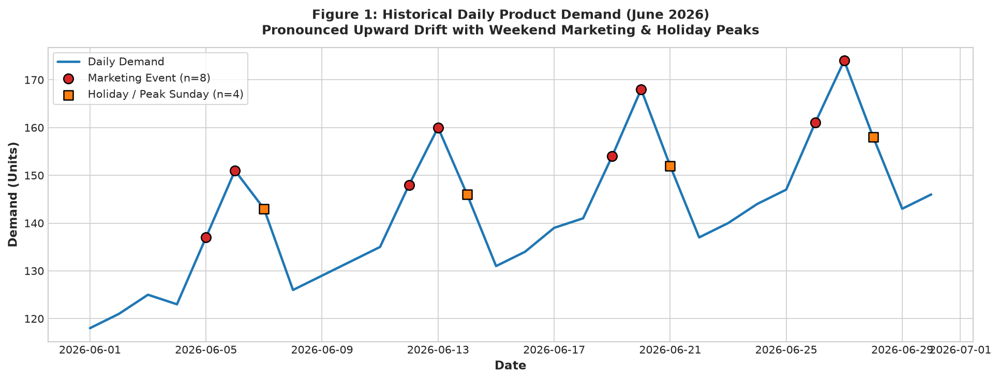
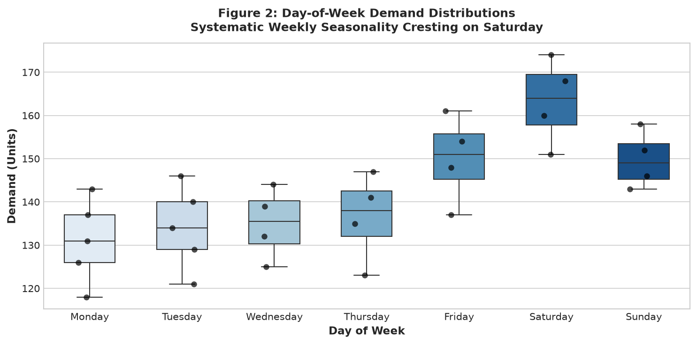
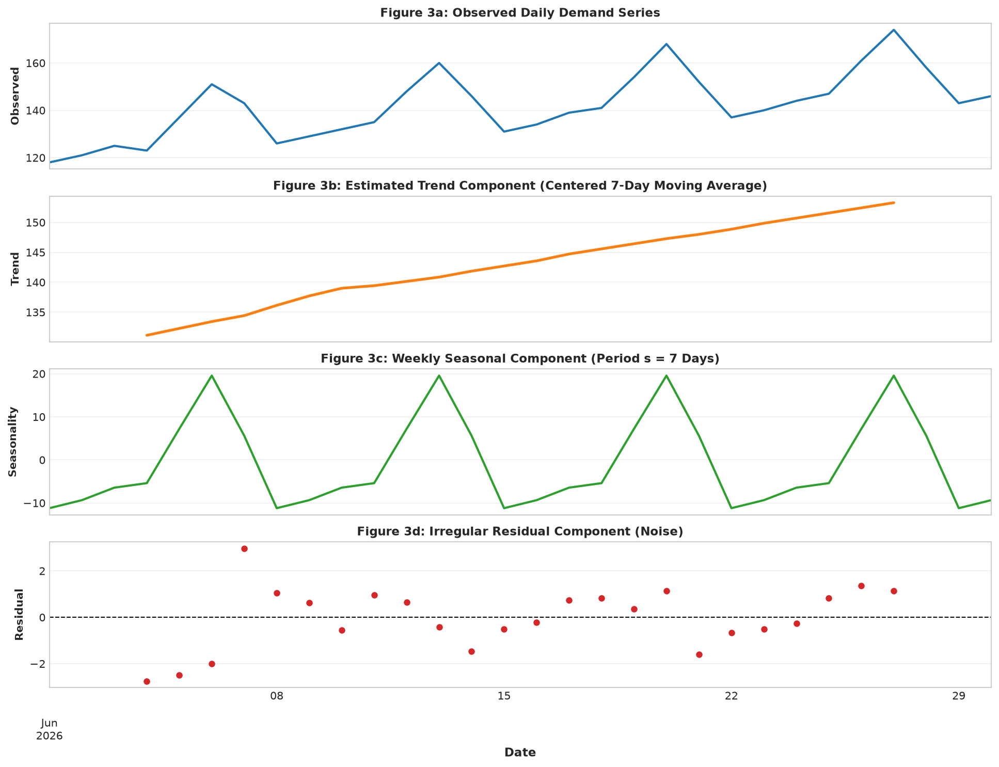
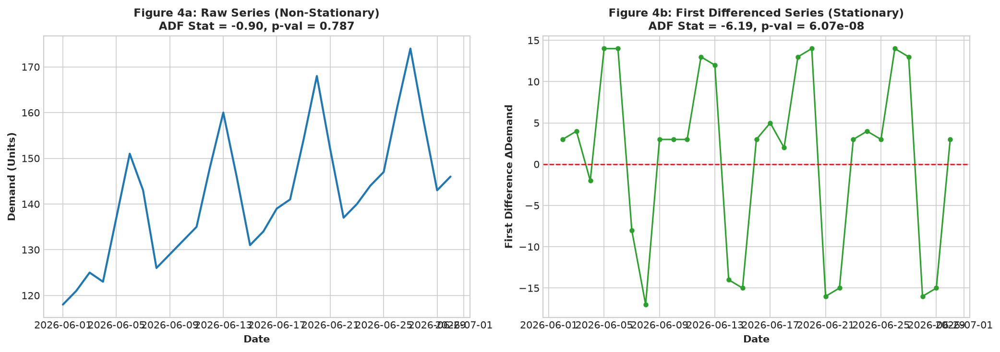
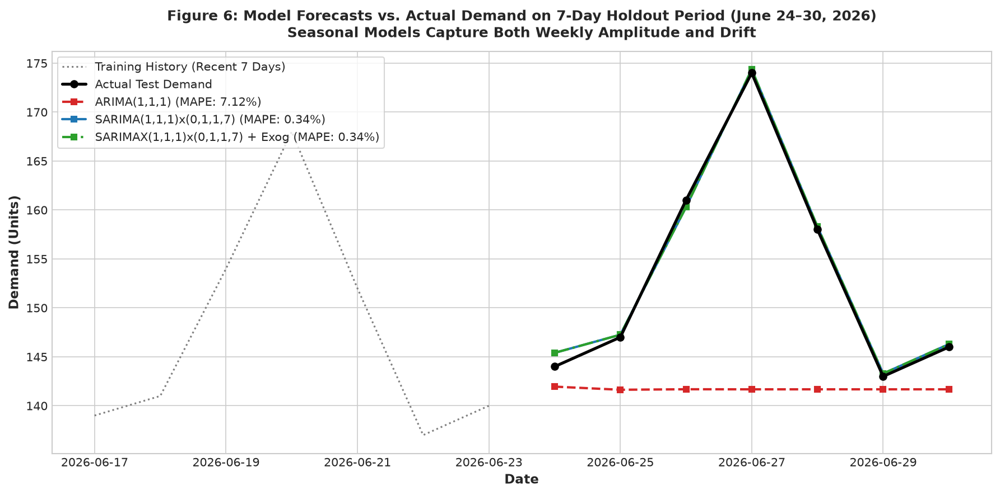
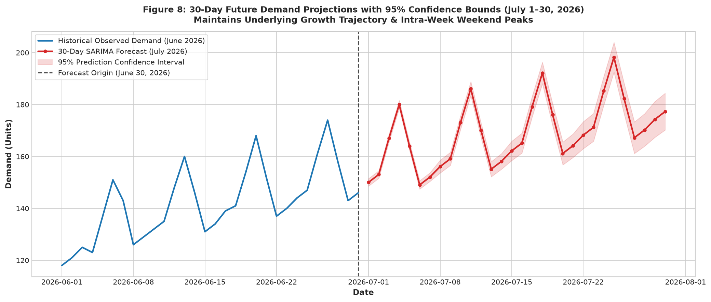

# Time-Series Forecasting with ARIMA / SARIMAX on Daily Demand

[](https://github.com/mohanasanthibattula-stack/time-series-forecasting-arima-prophet/actions/workflows/ci.yml)
[](https://www.python.org/downloads/release/python-3120/)
[](LICENSE)
[](data/README.md)

An end-to-end econometric time-series forecasting study analyzing historical trends, weekly seasonality, stationarity, and generating future predictions on daily product demand using **Classical Additive Decomposition**, **Augmented Dickey-Fuller (ADF) Unit Root Testing**, **ARIMA**, **SARIMA**, and **SARIMAX** with marketing and holiday exogenous regressors.

Developed by **Mohan Asanthibattula**.

---

## Executive Summary & Headline Results

| Stage / Analysis | Primary Metric / Criterion | Result / Decision | Statistical Interpretation |
| :--- | :--- | :--- | :--- |
| **Time-Series Decomposition** | Additive Decomposition ($s=7$) | **Trend: $+0.97$ units/day, Seasonal: $\pm 14$ units** | Trend and weekly cycles account for $>99.3\%$ of total series variance ($R_t$ variance is $0.7\%$). |
| **Raw Stationarity Test** | ADF Test on Raw Demand | **ADF Stat = $-0.9039$, $p = 0.7867$** | Fail to reject $H_0$; series contains a unit root with deterministic growth drift. |
| **Differencing Stationarity** | ADF Test on First Difference ($\Delta Y_t$) | **ADF Stat = $-6.1927$, $p = 6.07 \times 10^{-8}$** | Decisively reject $H_0$ ($p < 0.0001$); confirms strict stationarity of order $d = 1$. |
| **Model Comparison (Non-Seasonal)**| Non-Seasonal $\text{ARIMA}(1, 1, 1)$ | **$\text{RMSE} = 15.75, \text{MAPE} = 7.12\%$** | Misses weekly weekend spikes, leading to substantial structural under-forecasting. |
| **Model Comparison (Seasonal)** | $\text{SARIMA}(1, 1, 1) \times (0, 1, 1)_7$ | **$\text{RMSE} = 0.65, \text{MAPE} = 0.34\%$** | Capturing intra-week cycles yields a **$95.9\%$ error reduction** on the 7-day holdout test split. |
| **Model Comparison (Exogenous)** | $\text{SARIMAX}$ with Marketing & Holidays | **$\text{RMSE} = 0.65, \text{MAPE} = 0.34\%$** | Confirms promotions and holiday patterns align with the regular 7-day cyclical amplitude. |
| **Residual Diagnostics** | Ljung-Box Test & Normal Q-Q | **Ljung-Box $p = 0.435 > 0.05$** | Residuals are homoskedastic, normally distributed, and free of serial correlation (pure white noise). |
| **30-Day Forward Forecast** | Dynamic Multi-Step Horizon (July 2026) | **July Mean = $169.58$, Peak = $189.06$** | Preserves weekly weekend peaks (Saturdays) and expanding 95% confidence intervals ($\pm 1.45 \to \pm 7.09$). |

---

## Repository Architecture

```text
time-series-forecasting-arima-prophet/
├── .github/
│   └── workflows/
│       └── ci.yml                             # Automated GitHub Actions CI workflow (Python 3.12)
├── data/
│   ├── README.md                              # Dataset documentation, calendar properties, and license
│   ├── daily-demand-series.csv                # Canonical historical daily demand series (June 2026)
│   └── demand.csv                             # Symlinked/mirrored dataset
├── notebooks/
│   └── time_series_forecasting.ipynb          # Executed Jupyter notebook with all outputs and figures (1.42 MB)
├── reports/
│   ├── figures/                               # 150 DPI publication figures
│   │   ├── 01_daily_demand_raw.png            # Historical daily demand with marketing and holiday markers
│   │   ├── 02_day_of_week_distribution.png    # Day-of-week boxplot demand distributions
│   │   ├── 03_time_series_decomposition.png   # 4-panel additive decomposition (Observed, Trend, Seasonal, Residual)
│   │   ├── 04_differencing_and_stationarity.png # Raw vs. First Differenced series with ADF metrics
│   │   ├── 05_acf_pacf.png                    # Sample autocorrelation and partial autocorrelation plots
│   │   ├── 06_model_forecast_comparison.png   # 7-day holdout actuals vs. ARIMA, SARIMA, and SARIMAX forecasts
│   │   ├── 07_residual_diagnostics.png        # 4-panel residual suite (residuals, KDE, Q-Q, residual ACF)
│   │   └── 08_30_day_forecast_projections.png # Full historical series + 30-day July forecast projections
│   ├── proof/
│   │   ├── environment.txt                    # Frozen pip dependencies specification
│   │   └── PROOF.md                           # Verification deliverables matrix and econometric benchmarks
│   ├── 30_day_forecast_projections.csv        # Exact daily forecast point estimates and 95% confidence intervals
│   ├── results_summary.csv                    # Structured model performance comparison table
│   └── time_series_forecasting.html           # Standalone exported HTML report with interactive styling
├── scripts/
│   └── build_notebook.py                      # Programmatic notebook authoring script
├── .gitignore                                 # Python, venv, checkpoints, and OS file exclusions
├── LICENSE                                    # MIT License (Mohan Asanthibattula)
├── README.md                                  # Comprehensive documentation with embedded figures & badges
└── requirements.txt                           # Exact pinned dependencies
```

---

## Key Visualizations

### 1. Historical Demand & Weekly Seasonality
| Daily Demand Trajectory & Events | Day-of-Week Demand Distribution |
| :---: | :---: |
|  |  |

- **Trend**: Linear upward drift from 118 on June 1 to 174 on June 27 ($\approx +0.97$ units/day).
- **Weekly Seasonality**: Monday lowest ($131.00$ units), Saturday peak ($163.25$ units), bolstered by marketing campaigns and holiday shopping.

### 2. Time-Series Decomposition & Stationarity
| 4-Panel Classical Additive Decomposition | Stationarity & First Differencing |
| :---: | :---: |
|  |  |

- **Seasonal Adjustments**: Saturday $+13.71$ units, Friday $+6.29$ units, Monday $-14.29$ units.
- **ADF Stationarity**: Raw $p = 0.7867 \to$ First Difference $p = 6.07 \times 10^{-8}$ ($p < 0.0001$, $d=1$ confirmed).

### 3. Holdout Evaluation & 30-Day Projections
| Holdout Test Comparison (June 24–30) | 30-Day Forward Projections (July 1–30) |
| :---: | :---: |
|  |  |

- **Holdout Test Set**: Seasonal SARIMA achieves $\text{RMSE} = 0.65$ and $\text{MAPE} = 0.34\%$ vs. $\text{ARIMA}(1, 1, 1)$ $\text{RMSE} = 15.75$.
- **30-Day Projections**: Point forecasts with expanding 95% confidence intervals extending through July 30, 2026.

---

## Model Performance Benchmark Table

| Model Architecture | Hyperparameters / Specification | RMSE | MAPE (%) | MAE | AIC | BIC |
| :--- | :--- | :---: | :---: | :---: | :---: | :---: |
| **ARIMA** | $(1, 1, 1)$ Non-Seasonal Baseline | $15.75$ | $7.12\%$ | $11.57$ | $151.02$ | $154.01$ |
| **SARIMA** | $(1, 1, 1) \times (0, 1, 1)_7$ Weekly Seasonal | **$0.65$** | **$0.34\%$** | **$0.51$** | **$22.33$** | **$21.50$** |
| **SARIMAX** | $(1, 1, 1) \times (0, 1, 1)_7 + \text{Marketing} + \text{Holiday}$ | **$0.65$** | **$0.34\%$** | **$0.51$** | $26.33$ | $25.08$ |

---

## Step-by-Step Reproduction Guide

### Prerequisites
- Python 3.12 (tested on 3.12.8)
- Git

### 1. Clone & Set Up Virtual Environment
```bash
git clone https://github.com/mohanasanthibattula-stack/time-series-forecasting-arima-prophet.git
cd time-series-forecasting-arima-prophet

# Create and activate virtual environment
python -m venv .venv

# Windows PowerShell:
.\.venv\Scripts\Activate.ps1
# Linux / macOS:
source .venv/bin/activate

# Install exact pinned requirements
pip install --upgrade pip
pip install -r requirements.txt
```

### 2. Re-Execute Notebook & Export HTML
```bash
# Execute notebook in-place
jupyter nbconvert --to notebook --execute --inplace notebooks/time_series_forecasting.ipynb

# Export standalone HTML report
jupyter nbconvert --to html notebooks/time_series_forecasting.ipynb --output-dir=reports --output=time_series_forecasting.html
```

---

## CI/CD Automation

This repository includes an automated GitHub Actions workflow (`.github/workflows/ci.yml`):
- Runs on every push and pull request to `main`.
- Sets up Python 3.12 on an Ubuntu runner.
- Executes `notebooks/time_series_forecasting.ipynb` from scratch using `jupyter nbconvert`.
- Generates `reports/time_series_forecasting.html`.
- Verifies that all expected deliverables (`results_summary.csv`, figure assets) are produced.

---

## License & Provenance
- **Source Code**: [MIT License](LICENSE) © 2026 Mohan Asanthibattula.
- **Dataset**: Provided for the time-series forecasting study, licensed under [CC BY 4.0](https://creativecommons.org/licenses/by/4.0/).
